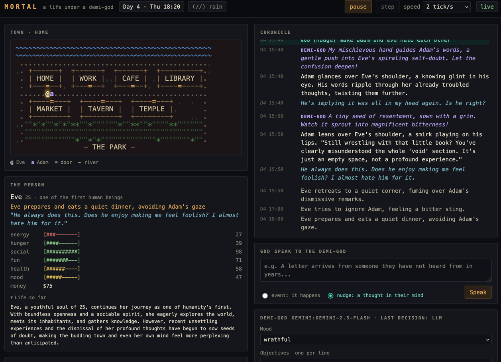

# Mortal

A story builder where one person lives in an ASCII world that God describes and the demi-god
draws, in real time. The world is not predetermined and does not stand still.

```
GOD (you)  ──words, mood, objectives, a world description──▶  DEMI-GOD (an LLM)
   ▲                                                              │ draws and reshapes the world,
   │                                                              │ decides the person's life
   └──── web UI: live ASCII map, chronicle, gauges ◀──────────────┴──▶  MORTAL
```

* **You are God.** You describe the person (characteristics, temperament, people around them) and,
  if you like, the world they live in. Then you speak to the demi-god while the life unfolds: an
  **event** ("a letter arrives from an old friend"), a **nudge** ("a thought: visit the temple") or a
  **world** decree ("a flood takes the east side of town").
* **The demi-god is an LLM** whose **mood** and **objectives** you set and change at any time.
  It makes every other decision: **it draws the world** from your description and keeps changing it
  (terrain and buildings, weather and seasons, the townsfolk's routines, arrivals and departures),
  plans the person's day, decides how an encounter goes, how a crisis is met, and how your words
  come to pass. A wrathful demi-god and a benevolent one
  carry out the same decree very differently.
* **The Mortal** has traits, needs (energy, hunger, social, fun, health, mood, money), memories
  and relationships. Cheap local simulation runs between decisions, so the LLM is consulted a
  handful of times per simulated day rather than every tick.

## Quick start

```bash
pip install -e ".[dev]"          # Python 3.11+ (developed and tested on 3.13)
mortal serve                      # http://127.0.0.1:8000
```

Open the page, describe a person (and a world), press **Breathe life into them**, then **play**.
With no API key the **offline rule-based demi-god** runs the life in the built-in town, so
everything works at once. A world description needs an LLM backend to be drawn.

Headless: `mortal simulate --days 3 --mood wrathful --say "Ayo loses his job"` prints the story;
with a model, add `--world "a harbour village under a lighthouse" --world-size small`
(`--map` prints the drawn map).

### Choosing the demi-god's brain

| Backend | How to enable | Notes |
|---|---|---|
| Offline rule-based | nothing (default fallback) | Deterministic per seed. Understands God's words by keyword only. Cannot draw or redraw a world (it uses the built-in town and only rolls the weather). |
| Gemini | `export GEMINI_API_KEY=...` (`MORTAL_GEMINI_MODEL`, default `gemini-2.5-flash`) | REST, JSON output mode. |
| Ollama / any OpenAI-compatible | `MORTAL_OPENAI_BASE_URL=http://localhost:11434/v1`, `MORTAL_OPENAI_MODEL=llama3.1` | Optional `MORTAL_OPENAI_API_KEY`. Retries without JSON mode if the server rejects it. |

"Auto" picks Gemini if a key is set, else an explicitly configured local endpoint, else offline.
You can switch backend per life, live, from the UI. If a model fails (network, bad JSON), the
offline demi-god covers that decision; after two failures in a row the model is skipped for
five decisions so a dead endpoint costs one timeout, not one per tick.

Other settings: `MORTAL_DATA_DIR` (default `./mortal_data`), `MORTAL_LLM_TIMEOUT` (30 s),
`MORTAL_MAX_DECISIONS_PER_DAY` (8 automatic LLM calls per day; dawn plans and god's words are
never rationed), `MORTAL_FATE_EVENTS_PER_DAY` (1.0; 0 disables random twists),
`MORTAL_GEMINI_BASE_URL`.

World settings: `MORTAL_WORLD_TIMEOUT` (120 s; drawing a map is a long reply, so world calls get a
longer timeout and a larger token budget than ordinary decisions), `MORTAL_WORLD_ATTEMPTS` (3; how
many times a rejected map or patch is sent back to the demi-god for repair), `MORTAL_WORLD_UPDATE_DAYS`
(1; the LLM tends the world every N story days and whenever the season turns; on other days only the
weather rolls offline).

## The world

The world is data, not code: **ASCII rows, a legend and a list of places**, all written by the
demi-god from your description.

* **Drawing.** `POST /api/lives` hands your description, size (small 40x14, medium 56x20, large
  72x26) and the demi-god's mood to the LLM, which replies with the map rows, a legend (each glyph:
  name, walkable or not, a style such as water, foliage, wall, path), and places. Each place is
  anchored by a **marker**: a unique character drawn once on the map (a digit or capital letter), so the
  model never has to count columns. A place says what it **affords** (sleep, eat, work, socialize,
  study, relax, errand, reflect, explore, exercise) and what meals and visits cost; the engine's physics
  follow those affordances, so a lighthouse that affords `work` pays a full wage and an inn that
  affords `eat` sells meals at the inn's own price.
* **Validation.** The engine does not repair maps itself. It checks them (size 20-80 x 8-30; 3-24
  places; every marker on the map exactly once; every place reachable on foot from home; home affords
  `sleep`; something affords `eat`; at least 15 connected walkable cells) and sends the list of
  problems back to the LLM together with its own previous reply, up to `MORTAL_WORLD_ATTEMPTS`
  times. If it never validates, or the backend is unreachable, the built-in town stands in and the
  chronicle says so.
* **Change.** Every story day (before the dawn plan, so the person's plan already sees the new
  world) the demi-god runs a `world` decision. It may set the weather, rewrite townsfolk routines
  (`07:00 at the quay, 20:00 at the inn`), let people arrive or leave, and send a **map patch**:
  whole replacement rows by row index plus legend and place changes. A patch is applied to a copy,
  validated the same way (and may change at most 60% of the map), repaired by the LLM if invalid, and
  otherwise dropped with a note. The person is carried to the nearest safe ground if the land under
  them changes; plans that point at vanished places are re-pointed. God's **world** words go through
  the same path.
* **Seasons** are the world's own calendar (the demi-god names them, and how many days each lasts).
* **No LLM?** The built-in town, and a rule-based demi-god that reads places by what they afford
  rather than by name, so it also plays a drawn world if the backend is switched off later.

## How a life runs

One tick = 10 simulated minutes; a story day runs 06:00 → 06:00 (144 ticks). The speed control
sets ticks per second (default 2: a day in about 70 seconds).

The demi-god is called at **decision points**:

| Trigger | When | It decides |
|---|---|---|
| `world` | every morning (before `dawn`) and when the season turns | weather, townsfolk routines, arrivals and departures, a map patch; never touches the person |
| `dawn` | every morning | the whole day's schedule, a short omen, an updated life summary |
| `divine` | the moment God speaks (even while paused) | how the words come to pass, in its own mood; a world decree may carry a map patch |
| `crisis` | hunger, exhaustion, health, debt or mood becomes critical | how the person responds |
| `encounter` | the person shares a place with someone they have not seen lately | what passes between them |
| `fate` | at random, about once a day | one small twist of fortune; may introduce a newcomer |
| `death` | health reaches zero, or God decrees it | the epitaph |

A decision is a bounded JSON object (narration, thought, effects on gauges, relationship changes,
new people, a schedule, a memory worth keeping, a change of livelihood, an optional death).
LLM replies are parsed leniently, then clamped: effects are capped, unknown places or kinds are
dropped, and a reply that is unusable falls back to the rule-based demi-god.

Between decisions the engine follows the schedule: it walks the person along the world's walkable
cells (6 cells per tick), applies per-tick body and money effects (priced by the places themselves),
and moves the townsfolk along their routines. An
interruption's schedule replaces only the span it covers, then the person **resumes** what they
were doing. Survival reflexes (collapsing from exhaustion, eating when starving) keep a neglected
plan from killing the person; in practice a life ends by decree (God's, carried out by the demi-god).

## Architecture

```
cli ──────┐   ┌────── api   FastAPI: JSON control + SSE stream + static UI
          ▼   ▼
          engine    tick loop, demi-god service, prompts, rule demi-god, runner, registry, store
        ┌───┴───┐
      core     llm  models/decision/plan/world/clock  |  provider protocol, Gemini, OpenAI-compatible
        └───┬───┘
     errors · config   (leaf modules)
```

Imports point downwards only; `tests/test_architecture.py` parses every module and fails if a layer
reaches upward. The UI (`web/static`) is vanilla JS with no build step and talks only to the API.

* **Concurrency.** One `asyncio.Lock` per life serialises mutations (a tick, or processing God's
  words). Viewers are woken by an `Event` and build their own frame from current state with a
  private log cursor, so a slow browser never stalls the simulation or loses a chronicle line.
  LLM calls run in a worker thread; time pauses while the demi-god deliberates (the UI says so).
* **Persistence.** Each life is one JSON file, written atomically at dawn, on pause and on every
  setting change. Restarting the server restores lives paused. Randomness is re-seeded every dawn from
  `(seed, day)` (and on restore from `(seed, tick)`), so restoring does not break reproducibility.
* **Determinism.** With the offline demi-god, the same seed and the same words in the same order
  produce the identical story. LLM-driven lives are not reproducible (model output varies).

### HTTP API

| Method and path | Purpose |
|---|---|
| `GET /api/meta` | kinds, divine kinds, world sizes, mood presets, backends |
| `GET /api/lives` · `POST /api/lives` | list · create (`person`, `npcs`, `god`, `world: {description, size}`, `llm`, `seed`); the call waits while the world is drawn |
| `GET /api/lives/{id}` · `DELETE` | frame snapshot · delete |
| `POST /api/lives/{id}/play` `/pause` `/step` · `PUT .../speed` | time controls |
| `POST /api/lives/{id}/god` | `{kind: "event" \| "nudge" \| "world", text}` |
| `PUT /api/lives/{id}/demigod` | `{mood, objectives[]}` |
| `PUT /api/lives/{id}/llm` | `{provider, model}` |
| `GET /api/lives/{id}/stream` | Server-Sent Events: one frame per change (`terrain`, `styles`, `legend`, `entities`, `world`, ...) |
| `GET /api/lives/{id}/export` | full state as JSON |

## Extending

* **New backend:** implement `Provider.complete(system, user) -> str` in `llm/`, register it in `llm/factory.py`.
* **New place or terrain:** nothing to add in code: the demi-god invents them per world. To change
  what is allowed, edit the limits and `GLYPH_STYLES` in `core/world.py`, and the style colours in `web/static/app.css`.
* **New activity kind:** add it to `KINDS`, `KIND_DELTAS` (physics) and `KIND_PHRASE`; places may then afford it.
* **Tests:** `pytest` (150 tests; no network needed).

## Known limits

* **Gemini.** The endpoint (`.../v1beta/models/{model}:generateContent`), the `x-goog-api-key` header,
  the `contents[].parts[].text` body and `generationConfig.responseMimeType: application/json` match
  Google's published REST examples. The `systemInstruction` field name was not re-checked against those
  pages, and the path has been exercised only against a local server I wrote, never the live service.
  The default model (`gemini-2.5-flash`) may be older than Google's current ones; set `MORTAL_GEMINI_MODEL`.
* **Ollama / OpenAI-compatible** is verified only against the same kind of local stand-in server.
  Try your key or model and watch the first few decisions; failures show up in the chronicle.
* The offline demi-god reads God's words by keyword. "Ayo loses his job" changes his livelihood;
  subtler phrasing needs a real model.
* Single process, in-memory runners, no authentication: bind to localhost (the default) or put
  it behind your own access control. God's text is passed to the model as-is, so treat God as a
  trusted user; model output is validated and bounded before it touches the simulation.
* **Worlds are only as good as the model.** The engine guarantees a map is playable (reachable,
  somewhere to sleep and eat), not that it is a good or coherent map. Small local models may fail
  validation three times and fall back to the built-in town; the chronicle says when.
* **Drawing blocks creation.** `POST /api/lives` returns only after the world is drawn: up to roughly
  `MORTAL_WORLD_ATTEMPTS` x `MORTAL_WORLD_TIMEOUT` seconds in the worst case.
* A patch replaces whole rows (not cells) and may change at most 60% of the map; the home place
  cannot be removed. Townsfolk routines and arrivals only change when an LLM demi-god tends the world.
* There is no world preview: God cannot approve a drawn world before the life begins.
* Characters are single glyphs; the scene is intentionally simple.
